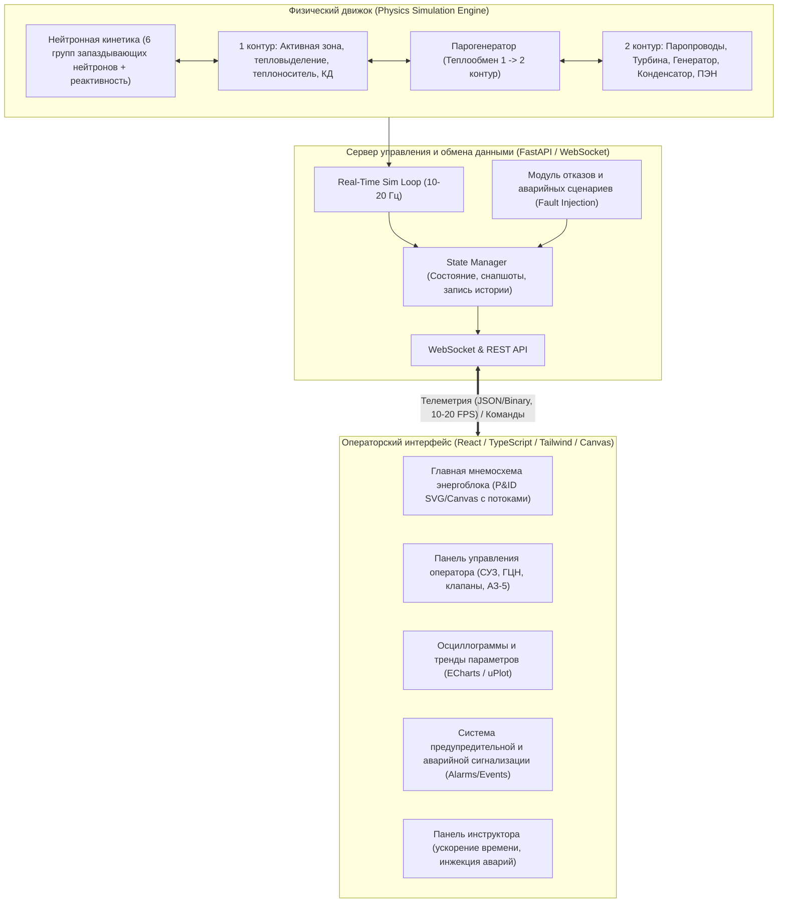

# Дорожная карта проекта: Веб-интерфейс симуляции и мониторинга процессов энергоблока АЭС

## Описание проекта и цель
Разработка интерактивной веб-платформы (SCADA / тренажер оператора энергоблока) для численного моделирования теплофизических и нейтронно-физических процессов двухконтурного ядерного энергоблока (типа ВВЭР / PWR) в реальном времени с возможностью мониторинга телеметрии, ручного и автоматического управления, ввода аварийных возмущений и анализа трендов.

---

## Ключевые архитектурные решения

### 1. Базовый тип энергоблока и модель физики
- **Базовый тип**: Обобщенная двухконтурная модель реактора под давлением (**ВВЭР-1000/1200** или **PWR**). Классический состав оборудования: реактор с СУЗ, компенсатор давления (КД), 4 петли/парогенератора (агрегированные до 1–2 эквивалентных петель для баланса наглядности и производительности), турбогенератор, конденсатор и питательный тракт.
- **Уровень глубины физики**: Точечная кинетика нейтронов с 6 группами запаздывающих нейтронов + температурные обратные связи (доплер-эффект топлива, замедлитель) + отравление ксеноном-135 + узловая гидродинамика и теплопередача (0D/1D). Шаг интегрирования 50–100 мс для стабильности в реальном времени.

### 2. Стек технологий
- **Backend / Моделирование**: Python (FastAPI + NumPy) с поддержкой WebSockets для низколатентного стриминга телеметрии.
- **Frontend**: React (Vite, TypeScript, TailwindCSS, Lucide-react, Canvas/SVG для интерактивной мнемосхемы P&ID, ECharts/uPlot для осциллограмм).

---

## Дорожная карта реализации (Roadmap)

### Этап 1: Архитектура и математический движок реакторной установки
- [x] Определение систем уравнений:
  - [x] Кинетика нейтронов: точечная кинетика с 6 группами запаздывающих нейтронов.
  - [x] Уравнения реактивности: стержни СУЗ, температурный коэффициент топлива (доплеровский эффект), температурный коэффициент теплоносителя, концентрация бора, ксенон ($Xe^{135}$) и йодная яма.
  - [x] Теплопередача в активной зоне: ТВЭЛ $\rightarrow$ оболочка $\rightarrow$ теплоноситель 1 контура.
  - [x] Компенсатор давления (КД): паровая подушка, электронагреватели (ТЭН), впрыск теплоносителя для поддержания давления ~15.7 МПа.
  - [x] Парогенератор (ПГ): передача тепла от 1 контура к котловой воде 2 контура, генерация сухого пара (~6.4 МПа).
  - [x] Турбина и конденсатор: баланс пара, мощность генератора (МВт эл.), конденсация, возврат питательной воды.
- [x] Модуль физического состояния (классы параметров: давление, температуры горячей/холодной нитей, уровень в КД/ПГ, расходы, электрическая и тепловая мощности).
- [x] Модульные тесты физической сходимости (проверка саморегулирования и стабильности стационарного режима 100% мощности).

### Этап 2: Бэкенд-сервис и потоковая передача данных (FastAPI + WebSocket)
- [x] Асинхронный цикл симуляции (`asyncio.create_task` с настраиваемой частотой тактов, например, 20 Гц / dt = 0.05с).
- [x] Механизм управления ходом времени: Start, Pause, Reset, TimeScale (1x, 2x, 5x, 10x).
- [x] Подсистема сериализации телеметрии (сжатие пакетов телеметрии для передачи по WebSocket в браузер).
- [x] REST / WebSocket API для команд управления:
  - [x] Изменение положения стержней СУЗ (ручное/автоматическое).
  - [x] Включение/отключение ГЦН (главных циркуляционных насосов).
  - [x] Управление ТЭНами и впрыском КД.
  - [x] Подача питательной воды и клапаны паропроводов (БРУ-К, БРУ-А).
  - [x] Кнопка аварийной защиты АЗ (SCRAM / АЗ-5).
- [x] Модуль сохранения контрольных точек (Save / Load State / Snapshots).

### Этап 3: Интерактивная мнемосхема энергоблока (P&ID Mimic Display)
- [x] Разработка визуальной векторной схемы (SVG/HTML5 Canvas):
  - [x] Корпус реактора с индикацией положения стержней и градиента температуры топлива.
  - [x] Петли 1 контура (горячие и холодные нити с динамической цветовой индикацией температуры).
  - [x] Насосы ГЦН (анимация вращения, статус работы/аварии).
  - [x] Компенсатор давления с индикацией уровня теплоносителя и фазового состояния.
  - [x] Парогенераторы с уровнем воды и генерацией пара.
  - [x] Главный паропровод, турбоагрегат, электрогенератор, конденсатор и насосы 2 контура.
- [x] Виджеты оперативных датчиков параметров (цифровые индикаторы с цветовыми предупреждениями по границам уставок).

### Этап 4: Пульт оператора и контуры автоматического регулирования
- [x] Панель органов управления:
  - [x] Индивидуальные переключатели приводов групп СУЗ (вверх, вниз, фиксация).
  - [x] Автоматический регулятор мощности (поддержание заданной электрической или тепловой мощности).
  - [x] Кнопка аварийной защиты реактора (АЗ-5) с защитной крышкой.
  - [x] Управление клапанами отсечки, регуляторами уровня в ПГ и КД.
- [x] Логика защит и блокировок (автоматическое срабатывание предупредительной защиты ПЗ и аварийной защиты АЗ при превышении давления, падении расхода, росте нейтронного потока или периода реактора).

### Этап 5: Подсистема трендов, осциллограмм и журнала сигнализаций (SCADA)
- [x] Компонент высокочастотных графиков реального времени (реактивность, мощности, давления в 1 и 2 контуре, средняя температура, уровень в КД).
- [x] Буфер ретроспективы (возможность промотать историю последних минут работы).
- [x] Журнал аварийно-предупредительной сигнализации (Alarm List):
  - [x] Цветовая классификация: Информационные (зеленый/синий), Предупредительные (желтый), Аварийные (красный).
  - [x] Фиксация времени события, квитирование оператором.

### Этап 6: Инструкторский режим и библиотека сценариев отказов
- [x] Панель моделирования нештатных ситуаций:
  - [x] *Отказ 1*: Отключение одного или всех ГЦН (обесточивание насосов).
  - [x] *Отказ 2*: Заклинивание рабочей группы стержней СУЗ.
  - [x] *Отказ 3*: Неконтролируемый сброс пара (разрыв паропровода 2 контура).
  - [x] *Отказ 4*: Течь теплоносителя 1 контура (малая течь / LOCA) с контролем срабатывания САОЗ.
  - [x] *Отказ 5*: Сброс электрической нагрузки турбогенератора (отключение от энергосистемы).
- [ ] Анализ действий оператора (оценка времени реакции и корректности действий по локализации инцидента).

### Этап 7: Сборка, контейнеризация и документация
- [ ] Упаковка в Docker Compose (бэкенд на FastAPI + фронтенд на Nginx/Vite).
- [ ] Руководство пользователя / оператора энергоблока с описанием технологических режимов (пуск с МКУ, подъем до номинала, аварийное расхолаживание).

---

## План верификации (Verification Plan)

### Автоматические тесты
1. **Тесты физической модели**:
   - `pytest tests/test_physics_kinetics.py` — проверка баланса нейтронов, времени запаздывания, стабильности на нулевой и номинальной мощности.
   - `pytest tests/test_thermal_hydraulics.py` — проверка закона сохранения энергии между 1 и 2 контурами.
   - `pytest tests/test_safety_trips.py` — проверка условий триггеров АЗ-5 (давление > 17.6 МПа, период < 10 с, мощность > 107%).
2. **Интеграционные тесты API**:
   - `pytest tests/test_api_stream.py` — проверка подключения WebSocket, задержки фреймов телеметрии (< 100 мс).

### Ручная верификация
1. Запуск симуляции из состояния 100% Nном: наблюдение за устойчивостью параметров в течение 5 минут.
2. Проверка перемещения стержней СУЗ: при вводе стержней мощность падает, температуры снижаются.
3. Нажатие кнопки АЗ-5: падение всех стержней на концевики, резкий сброс нейтронной мощности, переход на остаточное энерговыделение.
4. Проверка реакций мнемосхемы и индикаторов тревог в браузере.
